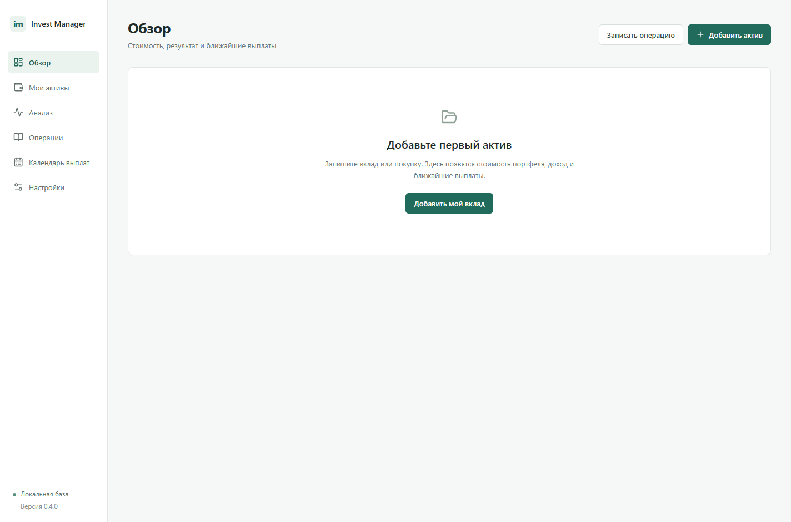

# Invest Manager

Локальное Windows-приложение для учёта и анализа личных инвестиций в Беларуси. Светлый русский интерфейс, SQLite, бесплатные источники. Первая версия — 0.1.0.



## Быстрый старт

Если есть готовый установщик, запустите `release/Invest-Manager-0.1.0-Setup.exe`. Для запуска без установки распакованная сборка находится в `release/win-unpacked/Invest Manager.exe`; переносить нужно всю папку `win-unpacked`, а не один EXE.

Для разработки нужен **Node.js 24 LTS x64**, npm и Windows 10/11:

```powershell
npm ci
npm run setup
npm run build
npm start
```

`setup` загружает официальный движок Electron. Для разработки с обновлением интерфейса: `npm run dev`.

```powershell
npm test                          # Финансовый учёт, SQLite, парсеры
npm run test:e2e                  # Проверка настоящего Electron через Playwright
npm run check:sources -- --live   # Проверка публичных источников (нужен интернет)
npm run pack                      # Приложение без установщика
npm run dist                      # Windows NSIS-установщик, без публикации
```

## Что работает

- Акции, облигации, долговые токены и депозиты, отдельно по площадке и валюте.
- Ручной ввод покупок, продаж, процентов, дивидендов, купонов, комиссий, пополнений и выводов. Редактирование и удаление с проверкой остатков.
- Причина **каждой покупки**, цель, горизонт, ожидания, риски и условия выхода.
- Денежные остатки, средняя стоимость, результат продаж, оценка открытых позиций, валютная переоценка, XIRR.
- Прогноз регулярных купонов, процентов и погашений. Полученный доход учитывается отдельно.
- Ежедневный автоматический расчёт начисленных процентов вкладов и XIRR с этой оценкой; actual/365–366, пополнения, снятия, капитализация и окончание срока. Поддерживается автообновляемая ставка НБРБ + надбавка с историей изменений.
- Анализ сценария покупки, сравнение с заданной ставкой депозита, YTM по регулярному графику, P/E, P/B, долг/капитал и маржа по введённой отчётности; SMA 20/50 и простой RSI 14 по сохранённым ценам.
- Публичные витрины [Finstore](https://finstore.by/kupit-tokeny/) и [Aigenis](https://aigenis.by/), [курсы НБРБ](https://api.nbrb.by/exrates/rates?periodicity=0). Источник и даты видны в интерфейсе.
- Резервное копирование и восстановление SQLite, экспорт операций и инвестиционных идей в CSV.

Первый запуск пустой: никаких выдуманных инвестиций. Нажмите «Добавить мой вклад», заполните условия и сохраните покупку. Для депозита **количество — сумма вклада, цена единицы — 1**. По умолчанию создаётся связанное внешнее пополнение на сумму покупки и комиссии. Если деньги уже внесены на счёт, снимите эту отметку.

По вкладам расчётные проценты автоматически включаются в результат и XIRR. Записанная фактическая выплата заменяет соответствующую расчётную сумму. При подтверждённой капитализации запишите выплату и покупку на эту сумму из остатка счёта. Автоматическая оценка не создаёт операций и не увеличивает доступные для расходов деньги. Авт расчёт можно отключить в карточке вклада.

## Данные и приватность

База установленной версии: `%APPDATA%/Invest Manager/data/invest.sqlite` (точный путь виден в настройках). Автокопии при запуске: соседняя папка `backups`, семь файлов по дням недели. Перед восстановлением создаётся дополнительная страховая копия рядом с базой. Восстановление заменяет текущие данные и запрашивает подтверждение.

**База и копии не зашифрованы; пароля и облачной синхронизации нет.** Защищайте их средствами учётной записи Windows. Ключи и пароли брокеров приложение не запрашивает. Каталоги площадок обновляются по команде. Для вкладов с привязкой к НБРБ публичная история ставок проверяется автоматически раз в день; персональные данные и параметры вклада в запрос не включаются.

SQLite, резервные копии, CSV, `.env`, локальные тестовые данные и установщики исключены из Git. Для переноса на другой компьютер используйте резервную копию, не GitHub.

## Границы первой версии

- Каталоги — открытые предложения с сайтов. Нет доступа к личным кабинетам, полному биржевому списку, стакану, автоматического импорта сделок или потоковых цен. Ручная котировка не заменяется ценой размещения из каталога.
- Автоматического извлечения отчётности, исторических цен и новостей пока нет. Эти исходные данные вводятся вручную. Полнота анализа прямо показана.
- Токены Finstore рассматриваются как долговые инструменты. Анализ свободно торгуемых криптовалют, токеномики и ончейн-данных — отдельный будущий модуль.
- Нет автоматических торговых поручений, платного ИИ, MOEX, налогового расчёта и брокерских форматов импорта. MOEX и новые источники добавляются отдельными адаптерами.
- Налоговый модуль выключен по требованиям пользователя. Это не заключение о налогах в Беларуси.
- Сборка без платного сертификата подписи. Windows может показать предупреждение о неизвестном издателе.

Подробные формулы и допущения: [docs/CALCULATIONS.md](docs/CALCULATIONS.md). Требования: [docs/REQUIREMENTS.md](docs/REQUIREMENTS.md). Архитектура: [docs/ARCHITECTURE.md](docs/ARCHITECTURE.md).

## GitHub

Создайте **приватный пустой репозиторий**. Данные приложения туда загружать не нужно.

```powershell
git add .
git commit -m "Initial Windows investment manager"
git branch -M main
git remote add origin https://github.com/YOUR_ACCOUNT/YOUR_REPOSITORY.git
git push -u origin main
```

Workflow `.github/workflows/windows.yml` проверит расчёты и интерфейс, соберёт установщик и сохранит его как артефакт workflow. Автоматической публичной публикации релизов нет.
